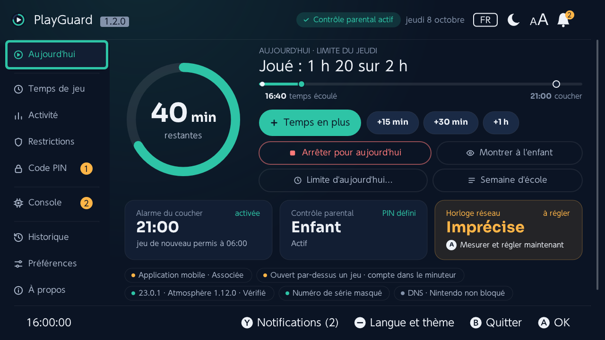

# PlayGuard


[](https://github.com/JigSawFr/PlayGuard/actions/workflows/build.yml)
[](https://github.com/JigSawFr/PlayGuard/releases/latest)
[](https://github.com/JigSawFr/PlayGuard/releases)
[](LICENSE)

[English](README.md) · **Français**

**Le contrôle parental de la Nintendo Switch, directement sur la console — sans application mobile, sans compte Nintendo, sans Internet.**

PlayGuard est un homebrew qui ramène sur la console, hors ligne, les réglages de l'application mobile [Contrôle parental Nintendo Switch](https://apps.apple.com/fr/app/contr%C3%B4le-parental-nintendo-sw/id1190074407) : limite quotidienne de temps de jeu, restrictions, code PIN, horloge réseau, activité de jeu — et un moyen de reprendre la main quand la console est bloquée. Ce qu'il couvre de l'application mobile, et ce qui manque encore : [docs/companion-app.md](docs/companion-app.md) (en anglais).



> [!WARNING]
> **Nécessite un firmware personnalisé (Atmosphère).** PlayGuard dialogue avec le service système restreint `pctl` : il ne fonctionne que sur une console modifiée. Il ne contourne aucune vérification de compte ou en ligne, et certaines des commandes utilisées sont des commandes `*ForDebug`. **À utiliser à vos risques.**

## Sommaire

- [Pourquoi PlayGuard](#pourquoi-playguard) · [Points forts](#points-forts) · [Compatibilité](#compatibilité) · [Installation](#installation) · [Premiers pas](#premiers-pas)
- [Console bloquée ?](#console-bloquée--console-doccasion-code-pin-oublié) · [Documentation](#documentation) · [Contribuer](#contribuer) · [Licence et remerciements](#licence-et-remerciements)

## Pourquoi PlayGuard

Les enfants aiment les jeux vidéo, et les jeux vidéo, ce sont des écrans : les limiter fait partie de prendre soin d'eux. Sur une Switch d'origine, l'application mobile de Nintendo s'en chargeait. En passant la console sous firmware personnalisé, le champ des possibles s'ouvre — mais le contrôle parental saute, car l'application mobile n'atteint plus la console. Savoir combien de temps ils ont joué, fixer une limite, faire arrêter le jeu sans bataille ni éternel « encore cinq minutes » devenait compliqué.

Les rares outils existants ne faisaient pas l'affaire : un suivi d'activité peu maintenu et peu détaillé, un contrôle parental peu développé et inabouti. Je ne voulais pas non plus d'un remplacement maison, ni d'un sysmodule qui tourne en permanence en arrière-plan. L'objectif : **réutiliser au maximum le contrôle parental de la console**, avec tout ce qu'il sait déjà faire — la limite, le code PIN, les avertissements, la suspension — et ramener ses réglages sur la console. C'est PlayGuard.

Piloter le contrôle parental de la console ouvre aussi la porte à bien plus : remonter le temps de jeu vers un serveur à la maison, recevoir des ordres, Home Assistant, des automatisations. Ce vers quoi cela pourrait aller est dans [l'horizon de la feuille de route](ROADMAP.md#horizon) (en anglais).

## Points forts

- ⏱️ **Limite quotidienne de temps de jeu** — la même tous les jours ou une par jour, modifiée sur un graphique de la semaine ; **profils** enregistrés (*Semaine d'école*, *Vacances d'été*…) ; **temps en plus aujourd'hui** et **arrêter le jeu pour aujourd'hui** en un appui.
- 📊 **Activité** — temps par jeu aujourd'hui, sur 7 jours et depuis toujours, par compte utilisateur, avec graphiques, un résumé par période, des jeux à redécouvrir et **export** en CSV, JSON, XLSX ou PDF.
- 🔒 **Restrictions et code PIN** — niveau de restriction, classification par âge et organisme de classification, définir / afficher le code PIN, déverrouiller temporairement, **verrou de console** en un interrupteur, et un code PIN optionnel pour ouvrir PlayGuard lui-même.
- 🕒 **Horloge réseau** — mesure sur des serveurs NTP publics et réglage, pour que le minuteur compte juste sur une console qui n'atteint jamais Nintendo.
- 📱 **Application mobile** — voir si elle est associée et la **dissocier**, même sur une console d'occasion.
- ↩️ **Historique, sauvegardes et retour arrière** — chaque modification faite par PlayGuard est consignée et peut être annulée ; les réglages peuvent être sauvegardés sur la carte SD.
- 🌍 **Toutes les langues de la console** — 15 catalogues, thèmes clair et sombre.
- 🛡️ **Écritures sûres** — le minuteur n'est jamais écrit pendant son décompte, et rien ne tourne en arrière-plan pendant que l'enfant joue.

| Temps de jeu | Limites par jour |
|---|---|
|  |  |
| **Activité** | **Un jeu** |
|  |  |
| **Restrictions** | **Horloge réseau** |
|  |  |
| **Sécurité et appli** | **Préférences** |
|  |  |

## Compatibilité

| | Pris en charge | Remarques |
|---|---|---|
| **Firmware** | **21.0.0 → 22.5.0** | La structure de la limite de temps de jeu (0x44 octets) existe depuis 21.0.0 ; en dessous, tous les onglets fonctionnent sauf le temps de jeu. 23.x passe par l'écran [firmware plus récent](docs/fr/compatibility.md#firmware-plus-recent) tant qu'il n'a pas été testé sur console. |
| **Atmosphère** | **1.11.x → 1.12.0** | 1.12.0 ajoute 23.0.0. L'application affiche la version détectée. |
| **Lanceurs** | hbmenu, **sphaira**, **Homebrew App Store** | Lancez-le par-dessus un jeu (title override), avec le compte d'un parent : la console compte le temps passé dans PlayGuard comme celui de ce jeu ([détails](docs/fr/compatibility.md#versions-prises-en-charge)). |
| **Testé sur console** | 22.0.0, 22.1.0, 22.5.0 | 23.0.1 / 1.12.0 a les mêmes commandes mais n'a pas encore tourné sur console : PlayGuard demande d'abord (lecture seule tant que vous n'avez pas choisi) — vos retours sont bienvenus. |
| **Nintendo Switch 2** | Non prise en charge | Atmosphère n'existe pas pour elle. |

Firmware plus récent, emuMMC et sysMMC, risque de bannissement, consoles sans Internet, et la comparaison avec un sysmodule de remplacement : **[docs/fr/compatibility.md](docs/fr/compatibility.md)**.

## Installation

Au choix :

| Canal | Comment |
|---|---|
| **Homebrew App Store** / **App Store de sphaira** (même catalogue) | Cherchez *PlayGuard* une fois la fiche validée. Les nouvelles versions sont reprises automatiquement. |
| **sphaira › GitHub** | Le zip de la version contient déjà l'entrée (`/config/sphaira/github/playguard.json`) : après une première installation, mettez à jour depuis *GitHub* dans sphaira. |
| **Manuellement** | Téléchargez `playguard.zip` dans la [dernière version](https://github.com/JigSawFr/PlayGuard/releases/latest) et extrayez-le à la **racine** de la carte SD. L'application arrive dans `sd:/switch/playguard/`, ses fichiers dans `sd:/config/playguard/`. |

Le **module système de récupération** optionnel (`playguard-rescue.zip`) se télécharge à part — voir [Console bloquée ?](#console-bloquée--console-doccasion-code-pin-oublié).

Les fichiers que PlayGuard écrit sur la carte SD : [docs/fr/install.md](docs/fr/install.md#fichiers-sur-la-carte-sd).

## Premiers pas

1. **Contrôle parental pas encore configuré ?** Ouvrez PlayGuard : le guide *Premiers pas* définit le code PIN (écran système), la limite quotidienne, et vérifie l'horloge réseau.
2. **Associé à l'application mobile ?** *Sécurité et appli › Dissocier l'application mobile* — sinon sa prochaine synchronisation écrase vos réglages.
3. Réglez la limite : *Temps de jeu › Même limite tous les jours* (ou *Limite différente selon le jour…*).
4. **Horloge réseau imprécise** (indiqué dans la Vue d'ensemble) ? Activez *Synchroniser l'horloge via Internet* dans les paramètres de la console, puis *Horloge réseau › Mesurer l'écart* et *Régler l'horloge réseau*. **Pas d'Internet ?** Laissez ce réglage désactivé et vérifiez d'abord l'horloge de la console : quand aucun serveur ne répond, *Mesurer l'écart* propose *Régler l'horloge réseau sur l'horloge de la console* ; n'activez le réglage qu'ensuite (avant, l'horloge de la console saute vers l'horloge réseau fausse).

**Commandes :** ↑/↓ déplacer · Ⓐ valider · Ⓑ retour ou annuler (deux fois sur la barre latérale pour quitter) · Ⓧ actualiser · **+** enregistre les limites par jour.

Chaque onglet en détail, les protections autour de l'écriture de la limite, et ce que la console compte comme temps de jeu : **[docs/fr/features.md](docs/fr/features.md)**.

## Console bloquée ? (console d'occasion, code PIN oublié)

PlayGuard ne voit que le contrôle parental du système sur lequel il tourne : **l'emuMMC et la sysMMC ont chacune le leur** (un code PIN supprimé sur l'une est toujours là sur l'autre). Lancez-le sur chacune de celles à corriger.

| Situation | Que faire |
|---|---|
| **Console d'occasion :** vous connaissez le code PIN, mais l'application mobile de l'ancien propriétaire est toujours associée (la dissociation échoue, ou la réinitialisation demande son compte) | *Sécurité et appli › Dissocier l'application mobile*, puis, si vous ne voulez plus du tout de contrôle parental, *Supprimer tout le contrôle parental*. Les deux fonctionnent hors ligne, en emuMMC comme en sysMMC. |
| **Code PIN oublié** | *Afficher le code PIN* demande lui-même le code PIN : il ne peut pas aider ici. Avec le module système de récupération installé (ci-dessous), déposez un fichier `RESCUE` et redémarrez : l'écran de récupération en définit alors un nouveau (il n'affiche jamais l'ancien). Sans lui, *Supprimer tout le contrôle parental* permet de repartir de zéro (une sauvegarde des réglages est d'abord enregistrée ; elle ne contient jamais le code PIN) : avec *Demander le code PIN* actif (par défaut, *Avant une modification*), mettez d'abord la carte SD dans un ordinateur et passez `"pin_lock"` à `"off"` dans `sd:/config/playguard/config.json`. |
| **Le minuteur bloque tout (limite à 0 min) et le code PIN est oublié** | PlayGuard lui-même ne peut pas démarrer. Installez **à l'avance** le module système de récupération optionnel (`playguard-rescue.zip`) ; une fois bloqué, déposez un fichier vide `config/playguard/RESCUE` sur la carte SD et démarrez — il déverrouille la console pour que PlayGuard puisse s'ouvrir. Voir [`sysmodule/README.md`](sysmodule/README.md) (en anglais). |
| **Console non modifiée** | PlayGuard ne peut rien faire : il nécessite Atmosphère. La procédure officielle passe par la clé maîtresse du service client de Nintendo. |

Signaler un bug (rapport de diagnostic, envoi en ligne) et le mode développeur : [docs/fr/troubleshooting.md](docs/fr/troubleshooting.md).

## Documentation

| Page | Contenu |
|---|---|
| [Fonctions](docs/fr/features.md) | Chaque onglet, les commandes, la sûreté par conception, ce qui compte comme temps de jeu |
| [Installation](docs/fr/install.md) | Les canaux d'installation, les fichiers écrits sur la carte SD |
| [Compatibilité](docs/fr/compatibility.md) | Firmware, Atmosphère, lanceurs, emuMMC / sysMMC, risque de bannissement, PlayGuard ou un sysmodule de remplacement |
| [Dépannage](docs/fr/troubleshooting.md) | Signaler un bug, le rapport de diagnostic, mode développeur |
| [Application mobile](docs/companion-app.md) (en anglais) | Ce que PlayGuard couvre de l'application mobile de Nintendo, et ce qui manque |
| [`config.json`](docs/config.md) (en anglais) | Chaque clé des préférences et l'état gardé d'un lancement à l'autre |
| [Fonctionnement du contrôle parental](docs/parental-controls.md) (en anglais) | Le service `pctl`, le minuteur et les horloges, mesurés sur console |
| [Module de récupération](sysmodule/README.md) (en anglais) | Le sysmodule de démarrage optionnel `RESCUE` |

## Contribuer

La compilation, le simulateur de bureau, l'architecture du code, le processus de publication et la traduction sont décrits dans **[CONTRIBUTING.md](CONTRIBUTING.md)** (en anglais). La suite, et les idées en attente d'une décision : **[ROADMAP.md](ROADMAP.md)** (en anglais).

**Sans code, en deux minutes :** si votre console est encore associée à l'application mobile, *Sécurité et appli › Avant de dissocier : aidez à décoder…* enregistre le bloc du minuteur ; vous changez un réglage dans l'application mobile (« alarme seule », ou un coucher pour un seul jour) et PlayGuard liste ce qui a changé. Joignez ce fichier à une issue : ce sont les données que la [feuille de route](ROADMAP.md#waiting-on-data-from-a-console) attend le plus.

En bref :

```sh
make test      # tests unitaires de la couche service C (sans devkitPro)
make desktop   # la vraie interface sous Linux, sur une console simulée
make dist      # playguard.zip (devkitPro switch-dev)
```

Les traductions par des locuteurs natifs sont particulièrement bienvenues — PlayGuard existe en anglais, français (France, Canada), allemand, espagnol (Espagne, Amérique latine), italien, néerlandais, portugais (Portugal, Brésil), russe, japonais, coréen et chinois (simplifié, traditionnel).

## Licence et remerciements

GPLv3 — voir [`LICENSE`](LICENSE). Maintenu par **[JigSawFr](https://github.com/JigSawFr)**.

- Fork de **Pctl Manager** de **Taylor** ([tailiang2008](https://github.com/tailiang2008)) (v2–v3) : couche de service pctl, garde-fou d'écriture du minuteur et interface borealis d'origine. Son historique est dans [CHANGELOG.md](CHANGELOG.md).
- Interface : **[borealis](https://github.com/xfangfang/borealis)** (Apache 2.0), figé dans `extern/borealis/`.
- QR codes : **[QR Code generator](https://github.com/nayuki/QR-Code-generator)** de Project Nayuki (MIT), dans `extern/qrcodegen/`.
- Icônes des notes de version : graphismes **[Twemoji](https://github.com/jdecked/twemoji)** (CC-BY 4.0), dans `resources/img/emoji/`.
- Diagnostic fw 22.5, libération de session et synchronisation NTP adaptés de **[anbingxi/NX-Pctl-Manager](https://github.com/anbingxi/NX-Pctl-Manager/tree/diag/fw22-5-readonly)**.
- Référence des commandes : [switchbrew — Parental Control services](https://switchbrew.org/wiki/Parental_Control_services).

> [!NOTE]
> **Comment PlayGuard est développé.** Des assistants de code à base d'IA ont été utilisés pendant le développement : écriture et relecture du code, traductions, documentation. Les changements de PlayGuard sont pilotés, relus et validés par un développeur professionnel, couverts par les tests unitaires C et le simulateur desktop, et testés sur une vraie console (22.0.0, 22.1.0 et 22.5.0 / Atmosphère 1.11.x) avant publication.

PlayGuard n'est ni affilié à Nintendo ni approuvé par Nintendo. Nintendo Switch est une marque de Nintendo.
