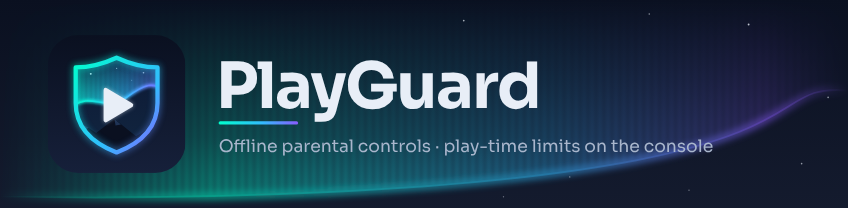
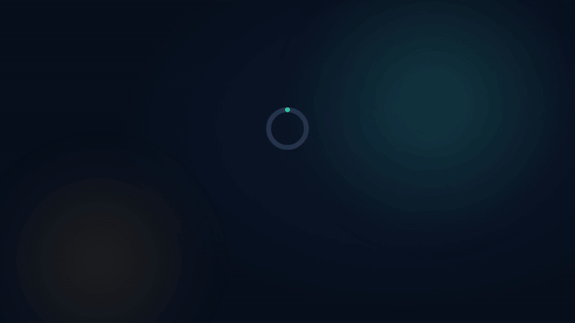

# PlayGuard

[English](README.md) · **Français**

**Le contrôle parental de la Nintendo Switch, directement sur la console — sans application mobile, sans compte Nintendo, sans Internet.**

PlayGuard ramène sur une console modifiée les réglages de l'application mobile [Contrôle parental Nintendo Switch](https://apps.apple.com/fr/app/contr%C3%B4le-parental-nintendo-sw/id1190074407). Il pilote le contrôle parental de la console elle-même (la limite, le code PIN, les avertissements, la suspension) : rien ne tourne en arrière-plan.

> [!WARNING]
> **Nécessite un firmware personnalisé (Atmosphère).** PlayGuard utilise le service restreint `pctl`, en partie via des commandes `*ForDebug`. **À utiliser à vos risques.**

## Fonctions

- ⏱️ **Limite de temps de jeu** — la même tous les jours ou une par jour, des profils, du temps en plus ou l'arrêt du jeu pour aujourd'hui en un appui.
- 📊 **Activité** — temps par jeu et par compte, graphiques, export en CSV, JSON, XLSX ou PDF.
- 🔒 **Restrictions et code PIN** — niveau de restriction, classification par âge, code PIN, déverrouillage temporaire, verrou de console en un interrupteur.
- 🕒 **Horloge réseau** — réglée depuis des serveurs NTP publics, pour que le minuteur compte juste sur une console qui n'atteint jamais Nintendo.
- 📱 **Application mobile** — la dissocier, même sur une console d'occasion.
- ↩️ **Historique et sauvegardes** — chaque modification est consignée et peut être annulée.
- 🔔 **Notifications** — une cloche regroupe ce qui demande votre attention (alarme désactivée, horloge décalée, modifications faites ailleurs), avec la correction à portée d'un appui.
- 🌍 Toutes les langues de la console, thèmes clair et sombre.

## Compatibilité

- **Testé sur console :** firmware 22.0.0 → 22.5.0, Atmosphère 1.11.x
- **Devrait fonctionner, non testé :** firmware 21.x (Atmosphère 1.10.x) et 23.0.x (1.12.0) ; firmware 20.x et antérieur avec son Atmosphère, tout sauf le temps de jeu
- **Lanceurs :** hbmenu, sphaira, Homebrew App Store

Le firmware 23.x et au-delà s'ouvre en lecture seule tant qu'aucune version ne le prend en charge. Pas de Switch 2 (Atmosphère n'existe pas pour elle). Détails : [compatibilité](docs/fr/compatibility.md).

## Installation

Cherchez *PlayGuard* dans le Homebrew App Store ou sphaira, ou extrayez `playguard.zip` de la [dernière version](https://github.com/JigSawFr/PlayGuard/releases/latest) à la racine de la carte SD. Lancez-le par-dessus un jeu, avec le compte d'un parent.

## Premiers pas

1. Ouvrez PlayGuard : le guide *Premiers pas* règle le code PIN et la limite quotidienne.
2. Encore associé à l'application mobile ? *Sécurité et appli › Dissocier l'application mobile*, sinon sa prochaine synchronisation écrase vos réglages.
3. Horloge réseau imprécise ? *Horloge réseau › Mesurer l'écart*, puis réglez-la. Sans Internet, lisez d'abord [ceci](docs/fr/compatibility.md#versions-prises-en-charge).

Code PIN oublié ou console d'occasion : [Console bloquée ?](docs/fr/troubleshooting.md#console-bloquée-)

## Documentation

- **Guide :** [fonctions](docs/fr/features.md) · [installation](docs/fr/install.md) · [compatibilité](docs/fr/compatibility.md) · [dépannage](docs/fr/troubleshooting.md)
- **Référence (en anglais) :** [application mobile](docs/companion-app.md) · [`config.json`](docs/config.md) · [fonctionnement du contrôle parental](docs/parental-controls.md) · [module de récupération](sysmodule/README.md)
- **Contribuer (en anglais) :** [CONTRIBUTING.md](CONTRIBUTING.md) · [feuille de route](ROADMAP.md) · [changelog](CHANGELOG.md)

## Licence et remerciements

GPLv3, voir [`LICENSE`](LICENSE). Maintenu par [JigSawFr](https://github.com/JigSawFr). Fork de [Pctl Manager](https://github.com/tailiang2008) de Taylor ; correctifs fw 22.5 et synchronisation NTP repris de [anbingxi/NX-Pctl-Manager](https://github.com/anbingxi/NX-Pctl-Manager/tree/diag/fw22-5-readonly). Construit avec [borealis](https://github.com/xfangfang/borealis) (Apache 2.0), [QR Code generator](https://github.com/nayuki/QR-Code-generator) (MIT) et [Twemoji](https://github.com/jdecked/twemoji) (CC-BY 4.0) ; référence des commandes : [switchbrew](https://switchbrew.org/wiki/Parental_Control_services). La vérification des jeux installés et ses réparations suivent [Goldleaf](https://github.com/XorTroll/Goldleaf) et [sphaira](https://github.com/ITotalJustice/sphaira) (GPLv3), avec les numéros de commandes ns et es de [libnx-ext](https://github.com/XorTroll/libnx-ext) (MIT).

Des assistants de code à base d'IA aident au développement ; chaque changement est relu, couvert par les tests unitaires et vérifié sur une vraie console avant publication.

PlayGuard n'est ni affilié à Nintendo ni approuvé par Nintendo. Nintendo Switch est une marque de Nintendo.
