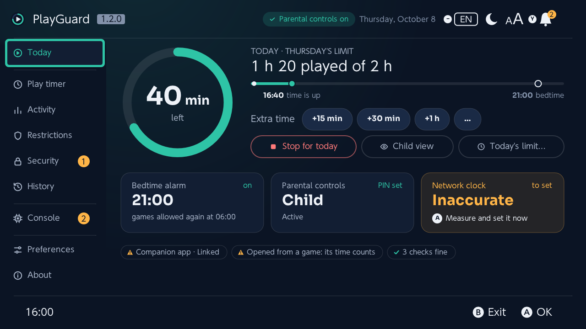
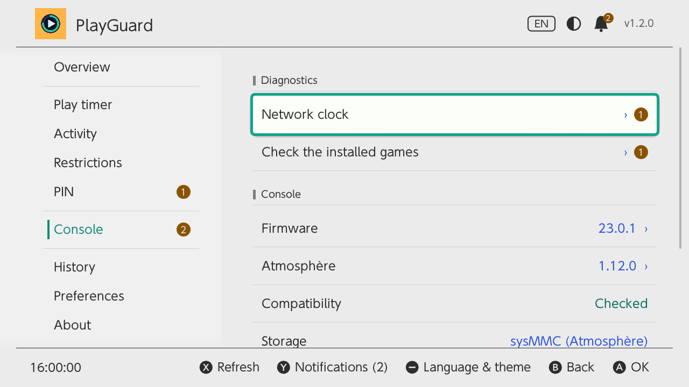
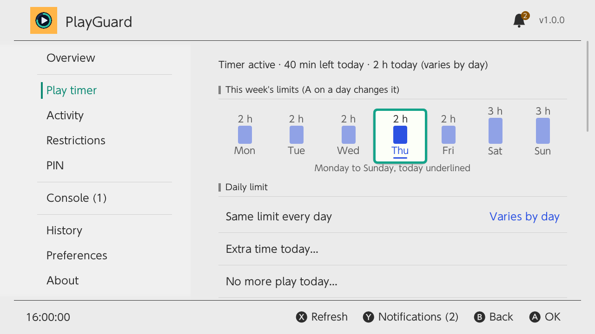
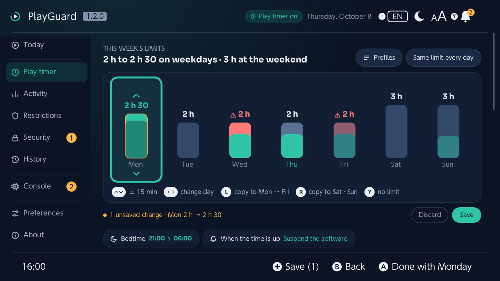
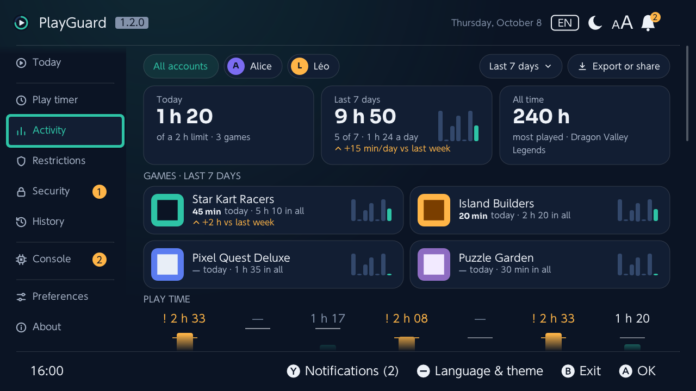
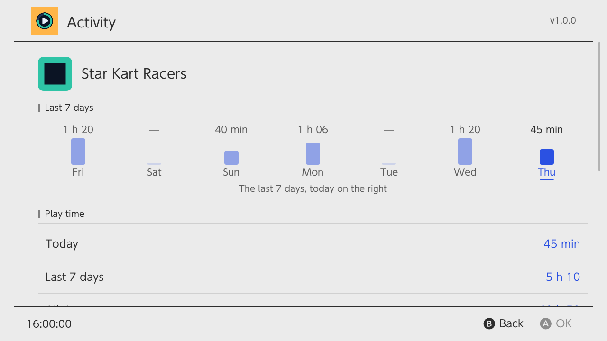
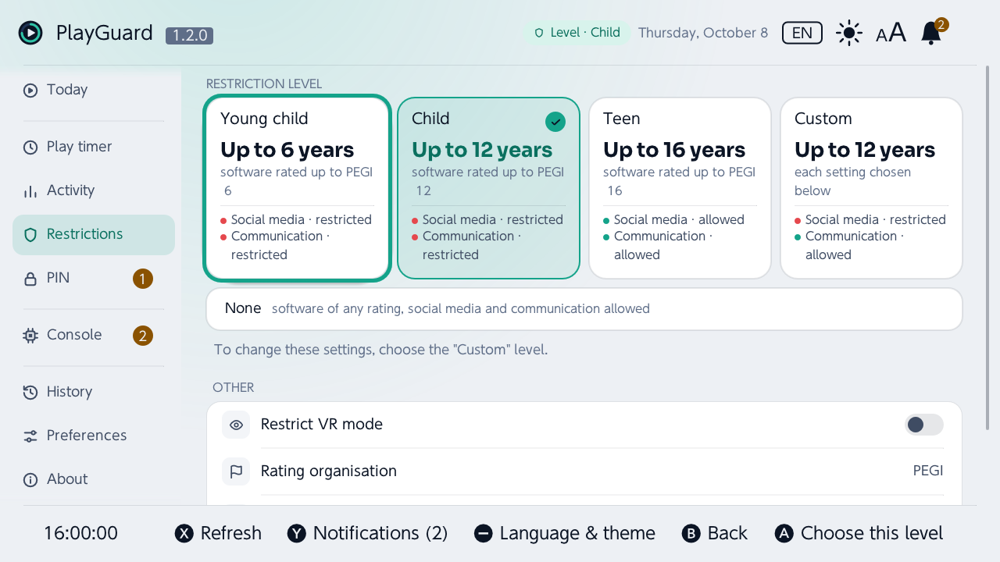
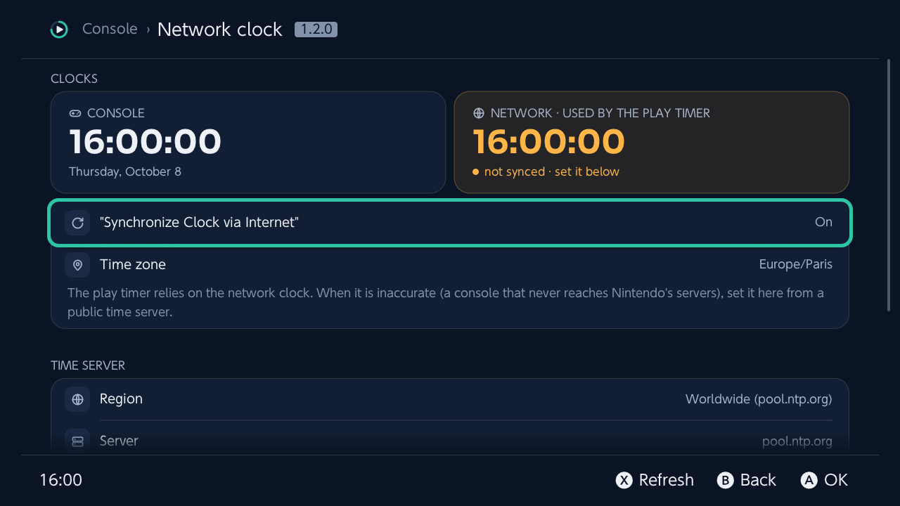
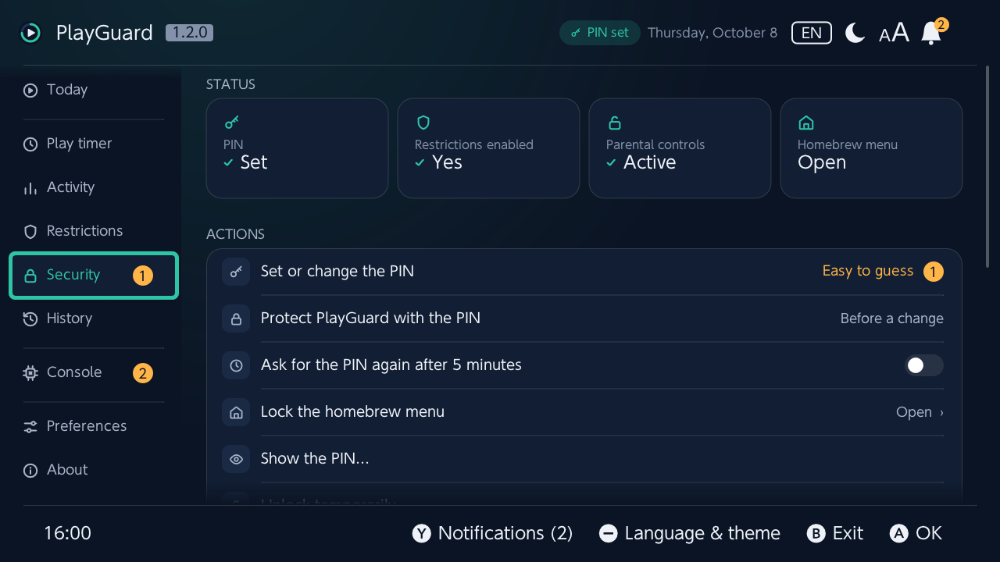
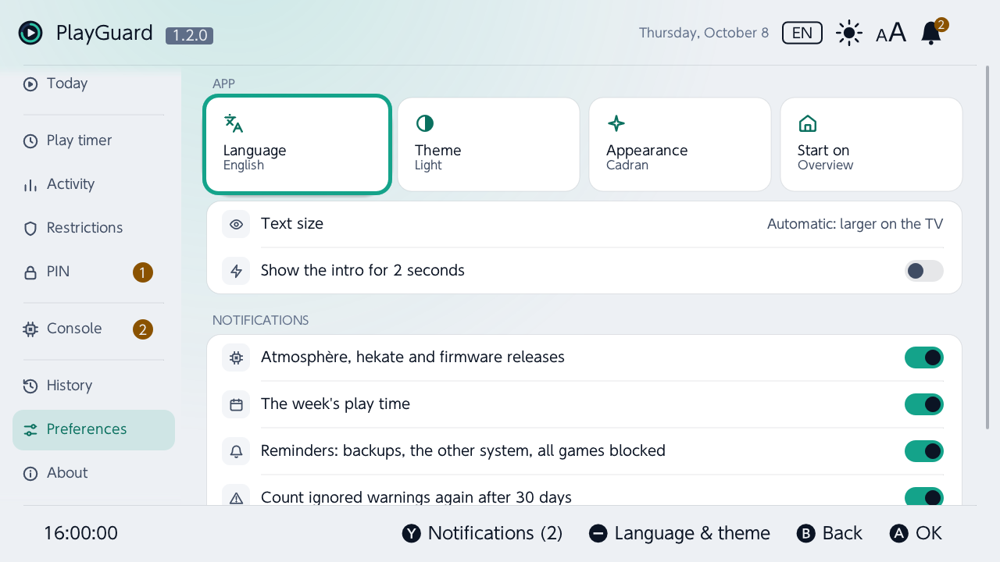

<!-- translated from docs/features.md, sha256 a59745a10580 -->
# 機能

各タブでできること、PlayGuard が安全に書き込むしくみ、本体がプレイ時間として数えるものについて説明します。トップページは [README](../../README.md)。

スクリーンショットは PlayGuard の初期設定であるベーシックブラックのテーマです（英語表示）。

| 今日 | 本体 |
|---|---|
|  |  |
| **プレイ時間** | **プレイ時間 › 曜日の編集** |
|  |  |
| **プレイ記録** | **ゲームの詳細** |
|  |  |
| **制限** | **本体 › ネットワーク時計** |
|  |  |
| **暗証番号** | **オプション** |
|  |  |

## 操作方法

↑/↓ 移動 · Ⓐ 決定 · Ⓑ 戻る・キャンセル（サイドバーで 2 回押すと終了） · Ⓧ 更新（本体の情報を読むタブで） · Ⓨ お知らせ · **−** 言語とテーマ（この 2 つはどのタブからでも使えます。フッターには表示されず、ヘッダーのベル・言語・テーマで示されます） · **+** 曜日ごとの上限を保存（*プレイ時間* で編集した週も）。

失敗したことはダイアログで、うまくいったことはトースト（短いメッセージ）で伝えます。ダイアログが伝えるのは、今のこの本体に当てはまることだけです。進行中のゲームが中断されることはゲームが開いているときだけ、スマホアプリが変更を上書きするかもしれないことは連携していて同期できるときだけ伝えます。みまもり設定が一時解除中であることはヘッダーのラベルがどのタブでも示し、アプリが閲覧のみであることはタイトルの右の斜線の入った鉛筆が示します。どちらもタップすると、それを元に戻せる場所に移動します（暗証番号 › みまもり設定を再び有効にする、ファームウェアの画面）。閲覧のみモードでは、操作はグレー表示のまま残り、選ぶと理由を表示します。

アプリは本体の「設定」のようにタブで構成されています。各タブについては、以下のセクションで説明します。

## 見た目：Cadran

PlayGuard の見た目は Cadran と呼ばれます。タブを並べたアイコンのレール、紺またはクールな白の配色（テーマに合わせて）、リストの代わりにカード。各タブは、いちばん大事なもの（リング、タイル、カード、チップ）から始まり、ほかの設定はその下にあります。

- ヘッダーのラベルは、そのタブが何についてのものかを示します（*みまもり設定 有効*、*タイマー作動中*…）。みまもり設定の一時解除中はどのタブでもそれを示し、タップすると *暗証番号 › みまもり設定を再び有効にする* が開きます。補助的な文字も 15 px 未満にはならないので、テレビならソファからでも読めます。
- ダイアログはカードで、ボタンは丸みのある形です。決定のボタンは青緑（何かを削除したり止めたりするときはコーラル）です。選択肢はボタンガイドの上にカードとして開き、今の選択は薄い青緑の地にチェックで示されます（青緑の枠はどこでもフォーカス専用です。レベル、ユーザー、適用中の選択は薄い地のままです）。長いダイアログは、続きがあるあいだ下端が薄れていき、その警告（もうすぐ中断されるゲーム）はオレンジのカードで最初に表示されます。失敗したときは、失敗したことがタイトルになり、エラーコードは理由の下に小さく表示され、役立つときは *レポートを送信* が表示されます。メッセージはヘッダーの下にカードとして表示され、実行したことには青緑のチェック、拒否されたことにはオレンジの印が付きます。
- ほかの画面も同じ見た目です。プリセットの曜日ごとの編集画面は *プレイ時間* と同じように週を表示し（編集のしかたも同じで、まとめて設定はタイルで並びます）、*インストール済みのゲームをチェック* と *すべてのゲーム* は各行をカードにし、*プリセット* と *ヘルプと診断* は各行にアイコンを付けます。
- **文字の大きさ**（*オプション*、またはヘッダーの **AA**）：初期設定の *自動* は、本体を TV モードでテレビに映している間はすべての文字を 25 % 大きくし、携帯モードでは元に戻します。*大きめ* は常に大きく、*標準* は常にそのままです。ヘッダー、サイドバー、フッターは大きさが変わりません（それ以上の余裕がないため）。すでに大きい *制限* のレベル名も同じです。変更は再起動なしで、すべての画面にすぐ反映されます。25 % という値は 4K の 55 インチテレビから決めたものです。いちばん小さい文字（15 px）は大文字の高さが 14.6 mm になり、2.5 m 離れたときの視角は 20′ で、楽に読める大きさです（標準の大きさでは 16′ で、ぎりぎりの最低限です）。
- **視覚効果**（*オプション*）：初期設定の *バッテリー時は軽く* は、充電器がつながっていない間（携帯モードで電源なし）、背景のグロー、子ども画面のリングが最後の数分に脈打つ動き、新しい値へ弧がなめらかに動くアニメーションを省きます。*常にすべて* はそれらを残します。5 秒ごとに確認し直すので、本体を電源につなぐと元に戻ります。
- 変更を保存したあと数秒間、フッターに **ZR** *元に戻す* が表示されます。変更履歴でその変更を開き、前の値に戻せます。変更履歴が空のときは、カードでそう伝えます。

## お知らせ — 対応が必要なことを、どのタブからでも

ヘッダーのバージョンの左にあるベルが、保護者の対応が必要なことをまとめます。どのタブからでも、Ⓨ で一覧を開けます（対応が必要なことが 2 つあると、ベルのバッジに *2* と表示されます）。

ベルの左には、言語（コード：*FR*、*EN*…）とテーマ（ベーシックホワイトは太陽、ベーシックブラックは月、本体の設定に従うときは半分塗られた円）、続いて文字の大きさ（**AA**。文字を大きくしている間は大きい A が青緑）があります。タップすると *オプション* と同じ一覧が開き、どのタブからでも **−** でこれらを選べます。新しい言語やテーマは PlayGuard を起動し直すと反映され、文字の大きさはすぐに反映されます。

- **対応が必要**（それぞれにオレンジの警告マーク。ベルにオレンジで数えられます）は、解決するまで残ります。暗証番号がまだない、誰もが最初に試す暗証番号（0000、1234、1212、2580…。本体上で判定し、表示はしません）、本体に暗証番号があるのに PlayGuard 自体は暗証番号なしで開く（*PlayGuardを暗証番号で保護* が *しない*）、みまもり設定の一時解除中（*再び有効にする*）、前の日の延長をまだ戻していない、「時間です」アラームがオフ、PlayGuard の外で行われた変更、本体がプレイ時間を数えていない、ネットワーク時計が不正確、です。
- **お知らせ**（それぞれに「i」。ベルに点が付きます）は既読にできます。前の日の *今日のプレイを終了* で下げたままの上限（*元に戻す*）、新しいバージョンのインストール（*新機能*。その場でアップデートしたあとは、前のビルドを保持）、オンラインで送信したレポート（*リンクを表示*）、この週のプレイ時間（既読にするまで 7 日ごと。前の週と比べた 1 日あたりの増減付き）と、本体が知らせるだけの設定で過去 7 日間のうち 2 日以上上限を超えたこと、設定のバックアップの推奨（まだない、または 30 日間ない）、すべてのソフトが 1 週間ブロックされている、新しいユーザーアカウント、前回 PlayGuard が予期せず終了した（*レポートを送信*）、スマホアプリとの連携、PlayGuard の新しいバージョン、起動時にネットワーク時計のずれが見つかった、です。
- **本体**：みまもり設定ではなく本体に関する項目は、最後に、Ⓐ で開く 1 行にまとめられます（ほかに何もないときは最初から開いています）。対応が必要な項目は、ベルではなく本体タブのバッジで数えられます。起動できないインストール済みのゲーム（*インストール済みのゲームをチェック*）、確認が必要なゲーム用パッチ、SD カードの空きがほとんどない（500 MB 未満）、PlayGuard 自身のファイルを退避できなかった、または SD カードに書き込めなかった、リカバリー sysmodule が古い（このバージョンに付属するものではない、またはバージョンを表示するようになる前にインストールされたもの。*更新* でこのバージョンに含まれるものを入れます）、続いてそれを使うための本体の再起動（再起動するまで）、起動を完了できずに前のビルドに戻したビルド（*レポートを送信*）、です。お知らせの項目は、前のビルドに戻した、このバージョンで未検証のファームウェア、Atmosphère・hekate・ファームウェアの新しいバージョン（*毎日アップデートを確認* で確認。ファームウェアの項目は、Atmosphère が対応するまで待つよう伝えます）、emuMMC でシリアル番号が非表示化されていない、もう一方のシステムの独自のみまもり設定、破損が見つかって退避した PlayGuard 自身のファイル（起動時のトーストがそこを案内します）、です。
- 各セクションの項目は、どのチェックが先に終わっても、決まった順に並びます。
- **サイドバー** では、タブ名の横のオレンジのバッジが、そのタブで解決する「対応が必要」な項目を数えます。暗証番号タブ（暗証番号なし、推測されやすい暗証番号、暗証番号なしの PlayGuard、一時解除中）、プレイ時間（アラームがオフ、本体が数えていない）、*今日*（PlayGuard の外で行われた変更、戻すべき延長）、本体（上記の項目と、ネットワーク時計）です。無視した項目とお知らせの項目は数えません。タブの中でも、それぞれを解決する行に同じバッジが付き（*ネットワーク時計*、*インストール済みのゲームをチェック*、*ストレージ*、*ゲーム用パッチ*、*暗証番号を設定・変更*、*PlayGuardを暗証番号で保護*、*みまもり設定を再び有効にする*、アラームはプレイ時間の *詳細*）、タブはその最初の行で開きます。
- 項目で Ⓐ を押すと、その場で解決する（*オンにする*、*合わせる*、*更新*…）か、解決できるタブを開きます。項目は、知らせている問題が解決すると自動で消えます。
- Ⓧ でお知らせの項目を既読に、Ⓨ ですべてを既読にします。一部の「対応が必要」な項目は、確認と暗証番号の入力のあとに Ⓧ で無視できます。誰もが最初に試す暗証番号、暗証番号なしで開く PlayGuard、「時間です」アラームがオフ、SD カードの空きがほとんどない、の 4 つです（暗証番号なし、一時解除中、時計、プレイ時間を数えていない、PlayGuard 自身のファイルは無視できません）。無視した項目は数えられなくなり、*無視中* の下に最後に表示されます。そこで Ⓐ を押すと、再び数えられます。無視した項目は、30 日後（*無視した警告を30日後に再び数える* がオフの場合を除く）、知らせていた問題がいったん解決して再び起きたとき、暗証番号については長さの違う新しい暗証番号にしたときに、自動で戻ってきます。
- 既読にしたお知らせの項目は、次の起動時も、内容が変わるまで既読のままです。*オプション › お知らせ* で 3 種類をオフにできます。Atmosphère・hekate・ファームウェアの新しいバージョン、この週のプレイ時間、リマインダー（バックアップ、もう一方のシステム、ソフトのブロック）です。
- もとになる状態は、PlayGuard の起動時、メイン画面では 1 分ごと、*今日* の表示中は 5 秒ごとに読み込まれます。

## 今日 — 1 日のようすをひと目で

*[シミュレーターで試す ›](https://playguard.link/simulator/)*

- **残り時間** をリングで表示します（プレイできない日は *0分* ではなく *プレイ不可* と表示します。今日与えた延長はリングの端に明るい部分として示され、リングは新しい値へなめらかに動きます）。その下には、最初にプレイを止めるものを表示します。時間切れやおやすみアラームより前なら、その日の残りを 1 本の線で示します。左端が現在で、それぞれに時刻付きの印が付きます（*16:40 時間切れ*、*21:00 就寝*）。線は最初の印まで青緑で、その最後の 15 分はオレンジになります。それ以外のときは文章で示します（その日の時間を使い切ったあとは、おやすみアラームと再び遊べる時刻。みまもり設定の一時解除中は、一時停止中の今日の上限とその理由）。
- **その横の操作：** *時間を延長*（延長する時間をワンタッチで選べます。時間にカーソルを合わせると、線の上の時間切れの印が *15分追加で* として動くか、おやすみアラームの印に、それでもアラームが先だと表示されます。残りが 15 分以下になるか、なくなると、最初の時間が青緑で目立ちます）、*今日は終了*、*子どもに見せる*、*今日の上限…*（今日の上限をその場で選び、1 回の確認のあとに書き込みます）。プリセットを保存したあとは、適用中のプリセットがその名前で表示されます（一致するものがなければ *プリセット…*）。Ⓐ で一覧が開き、適用中のものにはチェックが付いています。1 回の確認（変わる曜日を表示）のあとに別のプリセットを適用するか、*プリセットを管理…* を選べます。みまもり設定の一時解除中は、*再び有効にする* が先頭に行の幅いっぱいで表示され、*時間を延長* は表示されなくなります。どの曜日にも上限がない場合は、*週の上限を設定* で *プレイ時間* の週が開きます。
- **状態はカードとラベルで：** おやすみアラーム（再び遊べる時刻、または本体がそれを示さないときは、アラームが鳴るまでの時間。オフなら大きく *オフ* と表示し、Ⓐ で *設定する*）、みまもり設定、ネットワーク時計はカードで表示します。本体の状態はラベルで表示します（ひとつは Atmosphère の DNS リダイレクトが任天堂のサーバーをブロックしているかを示し、Ⓐ でどのサーバーか、それで何が変わるかを表示します。スマホアプリが同期しない、ネットワーク時計が自動で合わない、です。もうひとつは、ゲームの上から開いたときに、PlayGuard で過ごす時間も数えられることを示し、Ⓐ でそのしくみを表示します）。HOME メニューで開いたままのゲームは、オレンジのラベル（*カウント継続*。Ⓐ で理由を表示）で示します。ただし、ゲームの上から開いた PlayGuard についてのラベルがすでにそれを伝えているときは表示しません。ラベルは、保護者の対応が必要なもの（オレンジ、三角形付き）、有効なもの（青緑、チェック付き）、そのほか（グレー、点付き）の順に並びます。色だけでなく形でも区別できます。
- **はじめに：** 暗証番号と週の上限を設定するまで、カードの上にもう 1 枚のカードが表示され、3 つのステップ（暗証番号、1 日の上限、ネットワーク時計）が並びます。それぞれ、終わったものには青緑のチェック、まだのものにはオレンジの丸が付き、いくつ終わったか（*1 / 3*）も表示されます。ステップで Ⓐ を押すと、その場で設定できます。
- **本体は数えている？** PlayGuard 自身の時間も、アプリケーションとして動いている間は数えられます。そのため今日の上限があれば、開いている間に残り時間が減っていくはずです。画面上で約 90 秒たっても変わらない場合（タイマーが有効、今日の上限あり、一時解除中でない、アルバムから開いていない）、プレイした時間の下のオレンジの行に *本体は今、プレイ時間をカウントしていません* と表示され、考えられる原因が示されます。時計が戻された（あとでまたカウントされます）、ネットワーク時計が一度も設定されていない（*本体 › ネットワーク時計*）、上限を書き込んだ直後（ゲームを 1 分ほど起動してから確認してください）、です。残り時間が再び動けば、すぐに消えます。プレイ時間タブにも表示されます。
- **PlayGuard の外での変更：** 同じ日に今日のプレイ時間が最初からになった（時計の変更でそうなります）、本体の時計が 5 分以上動いた、PlayGuard が最後に見た上限と違う（スマホアプリや別のツール）。閉じる（Ⓐ）か翌日になるまでリングの上にオレンジのカードが表示され、変更履歴にも記録されます。PlayGuard はバックグラウンドでは動きません。わかるのは、開いている間か前回開いてから変わったことだけで、それも本体を読み直したときです。
- **上限に達すると**、本体は「時間です」と表示し、ゲームを中断する（「続ける」はできません）か、知らせるだけです。上限かおやすみアラームを設定すると、*時間になったとき* でどちらになるかを確認・変更できます（[詳細](../parental-controls.md#when-the-time-runs-out)、英語）。
- **今日の時間を延長**（初期設定は +15 分、+30 分、+1 時間）と **今日のプレイを終了**（今日だけ上限を 0 にします。プレイした時間がわかっていれば *今すぐ* か *5分後* を選べます。5 分後の場合、上限はプレイした時間 + 5 分になり、セーブする時間ができます。ロックされると本体の「時間です」が表示され、セーブしていない進行状況は失われることがあります。確認画面でもそのことを伝えます）。翌日（起動時、またはアプリを開いていれば 0 時に）、PlayGuard はいつもの上限に戻します。延長のあとは、確認も暗証番号もなしに自動で戻します（みまもり設定を再び有効にするときと同じく、上限を下げるだけだからです）。タイマーがカウント中なら一瞬だけ解除して、すぐにロックし直します。書き込めない間（閲覧のみモード、対応していないファームウェア、本体のロックがオン）は待ちます。また、1 週間後の同じ曜日で、下げた上限が進行中のゲームを止めてしまう間も待ちます（その場合は翌日に戻します）。ある日だけ多くの時間を残したいときは、その日の上限を変更してください。*今日のプレイを終了* のあとは、0 のままにするか上限を戻すかを尋ねます（上限を上げるほかの変更と同じく、暗証番号を使います）。または、ほかの変更と同じように自動で戻します（*プレイ時間 › 「今日のプレイを終了」の翌日に自動でいつもの上限に戻す*）。戻す先が「制限なし」の場合は、必ず確認します。
- **別の日の時間を延長**（*時間を延長 › 別の日…*、一覧の最後）：明日か、そのあとの 5 日間のどれか（それぞれ上限付きで並びます）を選び、続いて時間を選びます。その日の上限はすぐに、その日付だけ引き上げられ、その日が過ぎてから次に PlayGuard を開いたときに自動で戻ります（上限を下げるだけだからです）。PlayGuard を開かない本体では戻らず、次の同じ曜日もその上限のままです。設定できるのは一度に 1 つだけで、設定後は一覧から取り消せます（上限はすぐに戻ります）。その間にその曜日の上限を変更した場合（週の上限、プリセット…）は、そちらが優先され、何も戻しません。
- ラベルの下には、まだ戻していない延長（Ⓐ で戻します）と、オフになっている間の「時間です」アラーム（Ⓐ でオンに戻します）が表示されます。
- **子ども画面**（*今日* の *子どもに見せる*）：本体を子どもに渡すための画面です。表示するのは、残り時間（みまもり設定の一時解除中は、一時停止中の今日の上限）、プレイが終わる時刻（*16:40ごろ終了*。おやすみアラームのほうが先なら表示しません）、おやすみの時刻、時間になったときに起きることだけです。テレビに映して部屋の反対側からでも読める大きさで、文字の大きさの設定に関係なく、この大きさのままです。最後の 5 分間は、終わりの時刻がオレンジになり、リングがゆっくり脈打ちます。おやすみの時刻も、最後の 30 分間はオレンジになります。保護者用のボタンである Ⓐ と Ⓨ は右上に小さく表示されるので、フッターには子ども用のボタンだけが表示されます。Ⓐ で暗証番号を入力して保護者の画面に戻ります。Ⓨ で暗証番号を入力すると、その場で時間を延長できます（*時間を延長* と同じ時間。子ども画面のままです）。Ⓑ で PlayGuard を終了します（終了するときと同じく、先にみまもり設定を再び有効にするかを尋ねます）。
- 文字を大きくしても、*今日* は 1 画面に収まります。見出しの上の行が消え、ボタンとカードが少し詰まります。
- 5 秒ごとに更新されます（Ⓧ ですぐに更新）。

## プレイ時間 — 週がそのまま編集画面

*[シミュレーターで試す ›](https://playguard.link/simulator/?tab=play_timer)*

- **週がそのまま編集画面：** 曜日で Ⓐ を押すと編集できます。↑/↓ で 15 分ずつ変更、←/→ で次の曜日へ移動、Ⓛ で月曜日～金曜日にコピー、Ⓡ で週末にコピー、Ⓨ で制限なし、Ⓐ か Ⓑ で編集を終了します。Ⓧ で正確な時間を指定できます（*時間を入力…* で、↑/↓ で 15 分ずつ、Ⓛ/Ⓡ で 5 分ずつ設定します。OK にカーソルが合った状態で開きます）。タッチ操作では、曜日をタップすると編集になり、その上端か下端をタップすると 15 分ずつ変わります。変更は、曜日ごとの編集画面と同じく、**+** か *保存* でまとめて保存されます（確認画面には、変更した曜日が変更前 → 変更後で並びます）。*破棄* で元に戻ります。各曜日のバーの中には、その曜日の直近の日に遊んだ時間（今日を含み、すべてのユーザーの合計）が表示され、上限に達していれば上限とともにコーラルになり、週の下の凡例がその意味を示します（*上限超過*）。変更してまだ保存していない曜日は、上限がオレンジになり、バーがオレンジの枠で囲まれます。週の下には、選択中の曜日の数値が表示されます（*木曜日：1時間20分／2時間 プレイ*）。
- 週の上下にある **チップ** は、選択肢をすぐに開きます。プリセット（保存した数）、毎日同じ上限、おやすみアラーム、*時間になったとき*、制限の削除です。
- 週の上には、上限に達したことと、そのとき本体がどうするか、または本体がプレイ時間を数えていないことが、オレンジで表示されます。
- **毎日同じ上限：** よく使う値の一覧か、正確な時間です（*時間を入力…*：↑/↓ で 15 分ずつ、Ⓛ/Ⓡ で 5 分ずつ）。
- **平日と週末 ›：** 編集画面が、月曜日～金曜日の上限、続いて週末の上限を尋ねます。
- **今日の時間を延長** と **今日のプレイを終了**（*今日* と同じ）。
- その下に、上限に達したとき本体がどうするかの注記があります。みまもり設定の一時解除中は、プレイ時間が *数えられないかもしれません*。これはまだわかっていません（[ドキュメント](../parental-controls.md#still-open)、英語）。
- SD カードに保存する **プリセット**：適用（すでに適用中のプリセットなら、そう伝えるだけです）、編集、名前の変更、削除ができます。現在の上限を保存したり、新しく作ったりもできます。名前は自由で、どの文字でも使えます（*École*、*周末*、*Выходные* …）。ラテン文字を含まない名前には専用のファイル名が付き、同じファイル名になってしまう 2 つの名前は検出されます。
- **予約したプリセット**（*プリセット › 予約したプリセット*）：休暇や旅行など、期間を決めて使うプリセットです。最初の日と最後の日を、これからの 60 日間から選びます。期間が始まると、PlayGuard が適用するかを尋ねます（変わる曜日が質問の下に表示されます）。期間が終わると、置き換えた上限に戻すか、そのままにするかを尋ねます。尋ねるのは 1 日 1 回、メイン画面で、ほかに何も表示されていないときです。PlayGuard は開いたときにしか動かないので、PlayGuard を開かない本体は今の上限のままです。一度も適用されないまま過ぎた期間は、忘れられます。予約できるのは一度に 1 つだけで、その行から変更、取り消し、終了ができます。
- 確認画面にはいつも、変わる曜日が変更前 → 変更後で並びます。
- **おやすみアラーム**：アラームの時刻（16:00～23:45、またはオフ）と、再び遊べる時刻（05:00～09:00）。毎日同じにするか、アラームの一覧の最後にある *曜日ごとに…* から、月曜日～金曜日、週末、または 1 つの曜日に設定できます。ほかの曜日はそれまでの時刻のままです（曜日のまとまりごとに時刻が一覧になります）。曜日によって時刻が違う場合、タブには *曜日によって異なる* と表示され、*プレイ時間* の週には各曜日の名前の下にその日のアラームが表示されます。プレイ時間の設定の中でのその位置は、スマホアプリの設定から割り出したもので、本体（22.0.0）で検証済みです。それでも PlayGuard が変更するのは、PlayGuard がそこで読み取る値を本体が報告したときだけです。変更後は本体の応答を確認し、違っていれば前の設定に戻します。
- **時間の延長：** 提案する時間（+15/+30/+1 時間、+10/+20/+30 分 …）と、*今日のプレイを終了* のあと確認せずにいつもの上限に戻すかどうか（延長は常に確認なしで戻ります）。どちらも翌日以降、次に PlayGuard を開いたときに行われます。PlayGuard を開かない本体では、その日の上限のままです。
- **詳細 ›**（専用の画面）：デバッグ用の操作のスイッチと、それがオンの間は「時間です」アラームのオン/オフ、カウントの一時停止 / 再開。同じスイッチで、バックアップや履歴からアラームを元に戻せるようになります。
- `0` 分は *その日プレイ不可* という意味です。*プレイ時間の制限を解除* でタイマーをオフにします。

## プレイ記録 — 誰が、何を、どれだけ遊んだか

*[シミュレーターで試す ›](https://playguard.link/simulator/?tab=activity)*

- ゲームごとの時間を、**今日**、**過去7日間**、**これまでの合計** で、本体自身のプレイ記録から表示します。すべてのユーザーでも、**1 人のユーザー** でも表示できます（本体に複数のユーザーがいる場合は、上部のチップでユーザーを選びます）。PlayGuard は、最後に表示したユーザーか、*既定のアカウント* で設定したもの（すべてのユーザー、または 1 人）で開きます。
- **上部：** ユーザーのチップ、期間とエクスポート、今日・過去 7 日間・これまでの合計の数値（過去 7 日間の下には、その前の 7 日間と比べた 1 日あたりの差が表示されます。増えていれば ▲ *前週比 1日 +20分* のようにオレンジ、減っていれば ▼ で青緑、差が 5 分以内なら *前週と同じくらい*）、いちばん遊んだ 4 本のゲームのカード（Ⓐ で開きます。過去 7 日間では、前の週からいちばん増えたゲームに、30 分以上ならその差が表示されます：▲ *+2時間*）。期間中に何も遊んでいない場合は、カードでそう伝え、見るものがあれば *これまでの合計を見る* が表示されます。
- 過去 7 日間のグラフ（右端が今日、下に凡例）。各曜日の今週の上限が線で、上限を超えた時間はオレンジで ! 付きで示されます。今日、今週、これまでの合計も表示されます。
- 選んだ期間（今日、過去 7 日間、**過去30日間**、これまでの合計）の、表示中のユーザーの **概要**：1 日の平均、いちばん遊んだソフト、遊んだ日数といちばん遊んだ日（過去 7 日間）、1 回の平均プレイ時間（これまでの合計）。
- **遊んだ時間帯（過去7日間）**：曜日ごと、1 時間ごとのマス目で、月曜日から並び、たくさん遊んだ時間ほど色が濃くなります（すべてのゲーム、表示中のユーザー）。続いて、プレイの回数（5 分未満の休憩をはさむプレイは、ゲームを替えても 1 回と数えます）と 1 回の平均の長さ、いちばん長かった回とその日、いちばん遊んだ連続する 2 時間、21:00～06:00 に遊んだ時間です。
- **すべてのゲーム**（専用の画面）：期間中に遊んだすべてのゲームを、よく遊んだ順に **アイコン** のグリッドか **リスト** で表示します（Ⓨ で切り替え、選択は記憶されます）。選択中のゲームの数値は、常に上に表示されます。アイコンと名前、期間中のプレイ時間、これまでの合計、起動回数、最後に遊んだ日です。Ⓧ で期間を選びます（プレイ記録タブもそれに従います）。アイコンは選択中のゲームの周辺から読み込みます（メモリーを節約するため、アプレットモードでは読み込みません）。読み込まれるまで、またアイコンのないゲームには、グレーのコントローラーが表示されます。ゲームが多い場合は最初の 50 本を表示し、そのあとに *すべてのゲームを表示* があります（アプレットモードでは最大 100 本）。エクスポートには常にすべてが含まれます。PlayGuard が読み込むのは最大 256 本（今週のものが優先）です。それを超えると、プレイ記録タブ、すべてのゲーム、エクスポート（CSV 以外）が一部が欠けていることを伝え、これまでの合計にはそれらが含まれません。
- ゲームで Ⓐ：過去 7 日間の棒グラフ、起動回数、初めて遊んだ日と最後に遊んだ日、ユーザー別の時間。削除したゲームも、これまでの合計の数値が残ります。PlayGuard をインストールする前に削除したゲームでも、本体のプレイ記録に名前が残っていれば同じです。名前は、PlayGuard が一度見ていれば残ります（見ていなければ *削除したゲーム* とタイトル ID）。
- **ユーザーなしの時間と新しいユーザー：** どのユーザーにも属さないゲームの時間（ユーザーを選ばないゲームや、そのあと削除されたユーザー）は、1 分以上あれば *ユーザーなし* として表示されます。PlayGuard が初めて見るユーザーは、30 日間タブの中でオレンジで示され（*新しいユーザー（…から）*。新しいユーザーを作るのは、やり直すためによく知られた手口です）、変更履歴にも記録されます。PlayGuard が最初に一覧にしたときにいたユーザーには、印は付きません。
- **SD カードへのエクスポート**（*書き出し* チップ）：CSV、JSON、XLSX（Excel）、PDF。1 日 1 列で、そのあとに過去 7 日間、過去 30 日間、これまでの合計が続きます。
- **1週間のまとめをQRコードで表示：** スマートフォンのカメラで読み取ると、表示中の言語で数行のテキストになります。過去 7 日間とその平均、増減の傾向、日ごとの時間、いちばん遊んだ 3 本のゲーム、プレイの回数、いちばん長かった回、21:00～06:00 に遊んだ時間です。オンラインには何も送りません。
- 前回読み込んだ数値（起動をまたいで SD カードに保存）ですぐに開き、1 分以上たっていればバックグラウンドで更新します。Ⓧ で今すぐ読み直します（読み込み中はスピナーを表示）。
- 本体の時計を変更した場合、時間はおおよその値になります。

## 制限 — レベル、年齢区分、コミュニケーション

*[シミュレーターで試す ›](https://playguard.link/simulator/?tab=restrictions)*

- **制限レベル：** 小学生、中学生、高校生、カスタムがタイルで横に並び、それぞれ何を制限するかが表示されます（制限されるものには錠前、許可されるものにはチェック、そしてそのレベルでブロックされるインストール済みのゲーム。Ⓐ で設定。適用中の *カスタム* では、Ⓐ で下にあるその設定に移動します）。*なし* はその下にあります。レベルが何を制限するか（年齢、投稿、コミュニケーション）は、設定する前にもう一度伝えます。
- カスタムでは：年齢区分、SNS への投稿、他の人とのコミュニケーション。
- VR モード、**レーティング機関**（PEGI、ESRB、USK、CERO …）。一覧には、それぞれが対象とする国が表示されます（PEGI：ヨーロッパの大部分、ESRB：アメリカ、カナダ、中南米、USK：ドイツ、PEGI BBFC：イギリス…）。
- コミュニケーションを許可するソフトの数（一覧そのものは、構造がわかるまで、診断レポートに生のデータとして入ります）。
- **制限されるインストール済みソフト：** 適用中のレベルが年齢区分によって制限する、インストール済みのゲームの数（*3 / 15*）。Ⓐ でそれらを区分とともに一覧にします（*PEGI 16*）。各レベルのタイルにも表示されます（*制限されるソフト・3*）。区分は各ゲーム自身のもの（その管理データで、起動時のインストール済みゲームのチェック、または *本体 › インストール済みのゲームをチェック* で読み込みます）で、本体が使うレーティング機関のものです。その機関が区分していないゲームは数えず、スマホアプリで設定した例外も含みません。プレイ記録のゲームの画面にはその区分が表示され、制限される場合は *現在の制限レベルでは制限* と表示されます。

## 暗証番号 — 暗証番号、一時解除、ソフトのブロック、スマホアプリ

*[シミュレーターで試す ›](https://playguard.link/simulator/?tab=security)*

- **上部** には 3 つのタイルが並びます：暗証番号、制限、一時解除。それぞれ、あるべき状態（暗証番号が設定済み、制限がオン、ロック中）なら青緑のチェック、対応が必要ならオレンジの警告マークが付きます。
- **暗証番号の設定・変更**（本体の暗証番号画面）、**暗証番号の表示**（警告と暗証番号そのものの入力のあと。毎回求めます。履歴に記録され、そのあと新しい暗証番号への変更を提案します）、**一時解除**、**みまもり設定を再び有効にする**、そして一時解除が必要だった変更の直後に、PlayGuard が自動で再び有効にするかどうか（初期設定はオン）。
- PlayGuard 自体の **PlayGuardを暗証番号で保護**：*しない*、*変更する前*（初期設定。誰でも見られ、変更は保護者だけ）、*PlayGuardを開くとき*（起動時にロック画面）。一度入力すると、暗証番号は PlayGuard を閉じるまで有効です。*5分たったら暗証番号を再度確認する*（初期設定はオフ）をオンにすると、5 分後に再び求め、PlayGuard から 5 分以上離れて戻ったときに *PlayGuardを開くとき* のロック画面が再び表示されます。サービス層で確認するので、どの変更もこの確認を飛ばせません。再びロックするときは求めません。*暗証番号を表示* は、どのモードでも、入力した直後でも、毎回求めます。また、`config.json` がない、または壊れている場合は *変更する前* として扱います。みまもり設定が一時解除のまま終了しようとすると、再びロックするかを尋ねます（*有効にして終了* は、PlayGuard を起動したゲームも閉じ、hbmenu ではなく HOME メニューに戻ります）。代わりに HOME メニューから閉じた場合は、次の起動時に PlayGuard が再びロックします。本体を再起動しても、自動でロックされます。
- **すべてのソフトをブロック：** スイッチひとつで毎日の上限を 0 にし、ゲームを始めるには暗証番号が必要になります。年齢区分やコミュニケーションの制限のない、軽いブロックです。ブロックするのはゲームの起動で、HOME メニューではありません。暗証番号が必要です。オフにすると、前の上限に戻ります。オンの間は *時間の延長* と *今日のプレイを終了* が拒否され、ほかの方法で設定した上限（プリセット、バックアップ、履歴…）がこれに置き換わります。
- **スマホアプリ：** Nintendo みまもり Switch アプリが連携しているか、最後の同期、そして **連携の解除**（解除しないと、次の同期でここで設定した上限が上書きされます。連携中は、PlayGuard が確認を求めるすべての変更でそのことを伝えます）。Atmosphère の DNS リダイレクト（`atmosphere/hosts`）が任天堂のみまもり設定サーバーをほかへ向けている場合、アプリは同期できません。そのとき PlayGuard はここに *同期はブロック中（DNS）* と表示し、ほかの場所ではアプリについて何も伝えません（ダイアログの注記、ベルの項目、はじめにのステップ、*今日* のラベル、解読への協力はなく、連携の解除でも、アプリが何を上書きするかは伝えずに確認します）。連携していて同期できる間は、*連携を解除する前に：2つの設定の解読に協力* からブロックの比較を開けます（[CONTRIBUTING.md](../../CONTRIBUTING.md#no-code-needed)、英語）。
- **みまもり設定をすべて削除：** 確認は 2 回で、元に戻せません。先に設定のバックアップが保存されます。

## 本体 — ネットワーク時計、インストール済みのゲーム、本体で動いているもの

*[シミュレーターで試す ›](https://playguard.link/simulator/?tab=console)*

- **上部** には、本体で動いているものがタイルで並びます（ファームウェア、Atmosphère、SD カードにあれば hekate。Ⓐ でそのリリースノートを開きます）。続いて診断、そして本体の各行が、互換性から順に並びます（この本体のファームウェアで PlayGuard が確認済みなら青緑のチェックだけ、そうでなければ警告と何が問題か）。
- **ネットワーク時計 ›**（専用の画面） — タイマーが基準にする時計です。
  - 本体とネットワークの時計、タイムゾーン、正確さ。Atmosphère の DNS リダイレクト（`atmosphere/hosts`）が任天堂の時刻サーバー（`aauth-lp1.ndas.srv.nintendo.net`）をほかへ向けている場合、本体はネットワーク時計を自分で合わせられなくなります。この画面、ベルの項目、*今日* のカードがそのことを伝え、下の測定を案内します。
  - 公開 NTP サーバーを選ぶ（地域別に約 50 を内蔵、または自分で指定）。
  - 3 つのサーバーで **測定**（中央値。サーバー間で食い違うとオレンジの警告）し、**ネットワーク時計を合わせる**。測定結果はカウントダウン付きで 2 分間有効です。確認画面でも伝えますが、時計を変えると今日のプレイ時間がリセットされ、1 日の上限がすべて使えるようになります。
  - 任天堂のサーバーにつながらない本体では、この時計が不正確なままになり、タイマーが狂います。
  - **どのサーバーも応答しない**（インターネットのない本体）：結果の下に *ネットワーク時計を本体の時計に合わせる* が表示され（*今日* のネットワーク時計のカードでも、測定に失敗したあとに表示されます）、同じ確認画面を経て実行します。PlayGuard には本体の時計と比べるものがほかにないため、確認画面は本体の時刻を表示し、先にスマートフォンや時計で確かめるよう求めます。2026 年より前の本体の時計（一度も設定されていない）は拒否されます。*インターネットで時計を合わせる* がオフなら本体の時計はそのままで、あとでこの設定をオンにしても、時計が飛ぶことはなくなります。オンなら本体の時計はすでにネットワーク時計に合わせられているので、時刻が違っている場合はこの設定をオフにして手動で合わせるよう、確認画面が伝えます。書き込むのは時計だけで、みまもり設定ではないので、一時解除は不要です（*PlayGuardを暗証番号で保護* の暗証番号は引き続き必要です）。ほかの時計の変更と同じく、今日のプレイ時間はリセットされます。まだ本体では試していません。
  - 起動時のネットワーク時計のチェック（1 分以上ずれているとトーストを表示します。時計を合わせることはありません）。
- **インストール済みのゲーム：** HOME メニューで起動や表示ができないゲーム（読み込み中のままのアイコン、「!」、点線の枠）を、その原因（名前とアイコンが読めない、更新データはあるがゲーム本体がない、何もインストールされていない、ファイルの欠落、本体が見つけたデータの破損、ゲームまたはその更新データだけが新しいファームウェアを必要とする、ファームウェアに対して鍵が新しすぎる、ライセンス（チケット）がない、削除した更新データを本体が求めている、SD カードが読めない、本体が起動を拒否する）と対処法とともに、ゲームのアイコンの下に表示します。問題のあるインストール済みゲームの数も表示されます。一覧は対処法ごとのセクションに分かれます。**ここで修復**（PlayGuard が修復できるもの）、**要チェック**（本体が疑っているデータ。チェックすると、再インストールが必要かどうかがわかります）、**再インストール**（ファイルがない・使えない、またはデータの破損が見つかった。削除してから再インストール）、**ファームウェア/SDカード**（ゲームは正常で、問題は本体）です。それぞれに数と対処法があり、同じ問題のゲームはまとめて表示されます。同じ名前の 2 本のゲームは、バージョンかタイトル ID で区別できます。データチェックの結果は、別のバージョンがインストールされるまでゲームに記録されます。破損していれば *破損(チェック済み)* として、日付と本体のコード付きで *再インストール* に移り、問題なければ一覧から消えます。*この…本のゲームをチェック* は、*要チェック* 全体を 1 つのダイアログで 1 本ずつチェックし（*2/5本目*）、破損、問題なし、チェックできなかったゲームの数を伝えます。破損したゲームは、その場で削除できます。Ⓨ でゲームを選択し（前にチェックマーク）、セクションの上の *複数のゲームをまとめて* でセクション全体を選択できます。選んだゲームすべてに、ひとつの操作を実行できます。データのチェック、または削除（先に一覧を保存し、確認も暗証番号も 1 回だけ）です。*再インストール* の下では、一覧を保存でき（JSON とテキスト、エクスポートフォルダーに。名前、タイトル ID、バージョン、問題）、1 回の確認と 1 回の暗証番号ですべてをまとめて削除できます。先に一覧を保存してからゲームを削除するので、インストーラーがそれらをインストール済みとして数えることはなくなります。ひとつの操作で直る場合は、それがダイアログの最初のボタンです。そのあとに **その他の操作** が続きます。インストール済みのバージョンを再び許可（削除した更新データを本体が求めている場合）、更新データや追加コンテンツだけを削除、データの破損をチェック（本体自身のチェック。進み具合と中止ボタン付き）、ゲームを削除、です。バージョンはゲームと同じ形で表示されます（*バージョン1.4.0*、*更新データ #4*）。修復のあとは、ゲームが再び動くかをトーストで伝えます。セーブデータは常に残ります。すべての変更は変更履歴に記録されます。前回のチェック結果はすぐに表示され、そのあとは項目が変わったゲームだけを再チェックします（すべてのゲームをチェックするのは、1 日 1 回、ファームウェアのアップデート後、または Ⓧ *もう一度チェック* のとき）。チェックが終わったゲームから順に表示されます。複数のゲームが同時に壊れている場合は、SD カードか、もう一方のストレージ（sysMMC / emuMMC）からインストールしたゲームが原因と考えられます。セクションの上の *表示* で、*すべてのゲーム* と同じように、ゲームを **リスト** か **アイコン**（アイコン、名前、問題。選択は記憶されます）で表示できます。
- **本体：** ファームウェア、Atmosphère、hekate（SD カードに `bootloader/update.bin` がある場合）。それぞれ、前回のアップデート確認で見つかった新しいリリースがオレンジで表示されます（*22.0.0 · 23.0.1 が公開中*。2 つ以上遅れている場合は、いくつ遅れているかも）。最新のファームウェアが先に新しい Atmosphère や hekate を必要とする場合、またはまだそれらが対応していない場合は、ファームウェアの行に警告アイコンが付きます（理由はファームウェアのリリースノートでわかります。Atmosphère と hekate のリリースノートに、対応するファームウェアが書かれているためです）。それぞれで Ⓐ を押すと **リリースノート** が開きます。インストール済みのバージョンのタブ、新しいバージョンごとのタブ（最大 5 つ）、残りのタブに古いバージョン（全部で 6 つ。Ⓛ / Ⓡ で切り替え）があり、次のバージョンのタブで開きます。タグ（インストール済みまたは新しい、対応する最新のファームウェア、セキュリティ修正、ペアレンタルコントロールの変更）、公開されたままのノート（英語）、*オンラインで見る*（QR コード）、取得日時が表示されます。Atmosphère と hekate のノートは GitHub のリリースから、ファームウェアのノートは switchbrew から取得します。オフラインで読めるよう SD カードに保存され、1 日 1 回取得し直します（Ⓧ で今すぐ）。続いて、互換性、ストレージ（emuMMC か sysMMC。もう一方のシステムに独自のみまもり設定がある場合は情報アイコンが付き、Ⓐ で説明を表示）、Atmosphère が **シリアル番号を非表示化** しているか（Ⓐ を押すまで一部を隠して表示。emuMMC で非表示化されていない場合は、上の行に警告アイコンが付き、Ⓐ で説明を表示）、**ゲーム用パッチ**（sys-patch または sigpatch ファイル。ファイルだけを使っている場合は sys-patch をすすめます。情報アイコン、確認が必要なときは警告アイコンが付き、Ⓐ で説明を表示）です。

## 履歴 — 変更とバックアップ

*[シミュレーターで試す ›](https://playguard.link/simulator/?tab=history)*

- **変更履歴：** PlayGuard が行った最新 500 件の変更（上限、制限レベル、暗証番号、一時解除、連携の解除、時計、復元、カウントの一時停止や再開 …）と、PlayGuard の外で変わったのを見つけたことです。日ごとにまとめられ（*今日*、*昨日*、そのあとは曜日と日付）、時刻と変更元が表示されます。ある曜日だけの上限を変えた場合は、その曜日も表示されます。本体が **拒否した** 変更もオレンジで、本体のエラーと試みた内容とともに記録されます（何も変わっていないので、元に戻すことはありません）。*表示* で種類を絞り込めます（プレイ時間、制限、暗証番号、PlayGuard の外で検出、本体が拒否）。*表示中の内容をエクスポート* で、CSV、JSON、XLSX、PDF として `exports/` に書き出します。各変更には、それを行った PlayGuard のバージョンが記録されます。変更で Ⓐ を押すとその内容を表示し、値の変更なら **前の値に戻せます**。ほかの変更と同じ一時解除と暗証番号を使い、その後に値が変わっていれば、そのことを伝えます。新しいバージョンの PlayGuard が記録した変更は、*その他の変更* と表示されます。
- SD カードへの **設定のバックアップ / 復元**：制限レベル、カスタム設定、VR モード、レーティング機関、1 日の上限、「時間です」アラーム（詳細な操作がオンの場合）、そして記録用にプレイ時間の生のブロック。暗証番号は含みません。復元では変わる項目だけを一覧にし（変わるものがなければそう伝えるだけで、一時解除も書き込みもしません）、バックアップでおやすみアラームがオンだった場合は、そのことを伝えます（おやすみアラームは書き戻しません）。保持するバックアップの数を選べます。

## オプション

*[シミュレーターで試す ›](https://playguard.link/simulator/?tab=preferences)*

- PlayGuard 自体の設定：
  - 言語（本体のすべての言語、または本体の言語に従う）、テーマ（初期設定はベーシックブラック、ほかにベーシックホワイト、本体の設定）、文字の大きさ（自動 / 標準 / 大きめ。すぐに反映）。文字の大きさ以外は再起動を提案します。
  - 起動時のタブ。
  - 起動時の **イントロ**：2 秒間のロード画面（初期設定はオン。Ⓐ か Ⓑ でスキップ。オフにすると、準備ができしだい PlayGuard が開きます）。
- 表示するメッセージ：
  - お知らせの種類（上記参照）。
  - **毎月の PlayGuard の応援のお知らせ**（初期設定はオン。最初の 1 か月とアップデートの直後には表示しません。お知らせの *今後表示しない* かこのスイッチで、アップデート後も含めて完全にオフになります）。
- ひとつの機能に関わる設定は、その機能のところにあります。延長は *プレイ時間*、再び有効にする設定は *暗証番号*、時計のチェックは *本体 › ネットワーク時計* です。アップデートと *ヘルプと診断* は *情報* にあります。

## 情報

*[シミュレーターで試す ›](https://playguard.link/simulator/?tab=about)*

- インストールされている PlayGuard：バージョン（新しいバージョンが出ているとオレンジ。Ⓐ で **リリースノート** を開きます）、起動モード、データフォルダー。今すぐ **アップデートを確認** できます。起動時の *毎日アップデートを確認* と、*アップデート方法*：PlayGuard 内で（リリースをダウンロードして確認し、自分を置き換えて再起動します）、sphaira、Homebrew App Store、手動のどれか（何も選んでいなければ、最初のアップデートのときに尋ねます）。新しいリリースがわかっている間、PlayGuard は **PlayGuard X.Y.Z が利用できます**（日付とノート）の画面で開きます。*アップデート*、または *あとで*（1 日、1 週間、最大 30 日）を選べます。このリリースノートは PlayGuard 自身のもので、*本体* の Atmosphère や hekate のものと同じ画面です。GitHub のリリースから取得し、バージョンごとのタブ（インストール済み、新しいもの、古いもの）に、主な変更点のカードとすべての変更が表示されます。オフラインで読めるよう SD カードに保存されます（インストール済みのバージョンのノートはアプリにも入っているので、まだ何も取得していなくても読めます）。アップデート後は一度だけ、PlayGuard が **X.Y.Zの更新内容**（同じ主な変更点と QR コード）の画面で開きます。
- **ヘルプと診断 ›**（専用の画面、*アップデート方法* の下）：
  - **はじめに** でガイドをもう一度開けます（連携中は *スマホアプリとの連携を解除* のステップ、アラームがオフの間は *「時間です」アラームをオンに戻す* のステップ、暗証番号を設定したあとは *PlayGuardを守る* のステップ（*PlayGuardを暗証番号で保護* の選択）が加わり、起動時に表示しないためのスイッチもあります）。*閉じる* の下の *PlayGuardを応援する* で、支援用の QR コードを表示します。
  - **診断レポートをエクスポート**、または **オンラインで送信**（[不具合の報告](troubleshooting.md#不具合の報告)を参照）。保存したレポート、クラッシュファイル、セッションログ、オンラインで送信したレポートのリンクをいくつ残すかも設定できます（件数、日数、容量で指定）。
- クレジット、**PlayGuard を応援する** 方法（[GitHub Sponsors](https://github.com/sponsors/JigSawFr)、[Ko-fi](https://ko-fi.com/jigsawfr)。スマートフォンで読み取る QR コードで表示）、そして小さな *Made in France* 🇫🇷。

## 安全を考えた設計

**プレイ時間の上限を安全に書き込む。** タイマーのカウントダウン中にその設定を上書きすると、Atmosphère が不安定になります。そこで PlayGuard はまず状態を確認し、タイマーが有効なら、みまもり設定を一時解除することを確認画面で伝えます。保存されている暗証番号を使うので、**暗証番号を覚えておく必要はありません**。ボタンを 1 回押すと、解除し、システムが解除を報告したことを確認し、書き込み、**すぐにロックし直します**（*変更後にみまもり設定を再び有効にする* がオフなら、ロックし直すかを尋ねます）。サービス層が書き込む直前に状態を再確認するので、どの画面もこの安全策を飛ばせません。

> [!CAUTION]
> 今日すでにプレイした時間より低い上限にすると、みまもり設定がロックし直された時点でゲームが中断されます。そうなる場合は、確認画面で伝えます。

**22.5 のクラッシュはもうありません。** みまもり設定の特権サービス `pctl:a` は、**セッションを 1 つしか** 受け付けません。元のアプリの古いビルドはこれを開いたままにしていたため、HOME メニューの暗証番号入力（または暗証番号アプレット）がセッションを得られず、Atmosphère がクラッシュすることがありました。PlayGuard は操作のたびにセッションを開き、すぐに解放します。アプリがバックグラウンドにある間は、定期的な更新を止めます。*（原因の特定は [anbingxi のフォーク](https://github.com/anbingxi/NX-Pctl-Manager/tree/diag/fw22-5-readonly) によるものです。）*

**バックグラウンドでは何も動きません。** 制限時間、暗証番号、通知、中断は本体自身のものです。PlayGuard はその設定を変えるだけです。

## プレイ時間として数えられるもの

タイマーは本体のものです。PlayGuard はそれを読むだけで、自分では何も数えません。わかっていることと、その確かさは次のとおりです（測定結果は [parental-controls.md](../parental-controls.md#time-spent-and-time-left)、英語）。

- ゲームのプレイ中 — はい *（測定済み（22.0.0））*
- **HOME メニューで開いたままのゲーム**（バックグラウンドで中断中） — **はい**：ゲームを終了するか、本体をスリープモードにしてください *（保護者からの報告（[Arqade](https://gaming.stackexchange.com/questions/398954/)）。測定結果とも一致します（アプリケーションが開いている間、本体は数えます））*
- スリープモード — いいえ *（報告あり（[Arqade](https://gaming.stackexchange.com/questions/398954/)）。PlayGuard では未測定）*
- **ゲームの上から開いた PlayGuard**（アプリケーションとして） — **はい**、そのゲームとして数えられます *（測定済み（22.0.0）。保護者のユーザーで開くか、ちょっと見るだけならアルバムから開いてください）*
- アルバムから開いた PlayGuard（アプレットモード） — いいえ *（推測。アプリケーションではなく、アプリケーション以外の時間は数えられないようだったため）*
- みまもり設定の一時解除中 — 数えられないかもしれません *（未測定。まだわかっていません）*
- 時計を変更したあと — その日は最初からになります。時計を戻した場合は、時計が元の時刻を過ぎるまでカウントが止まります *（確認済み（22.0.0）。本体が数えていないときは、*今日* で伝えます）*
